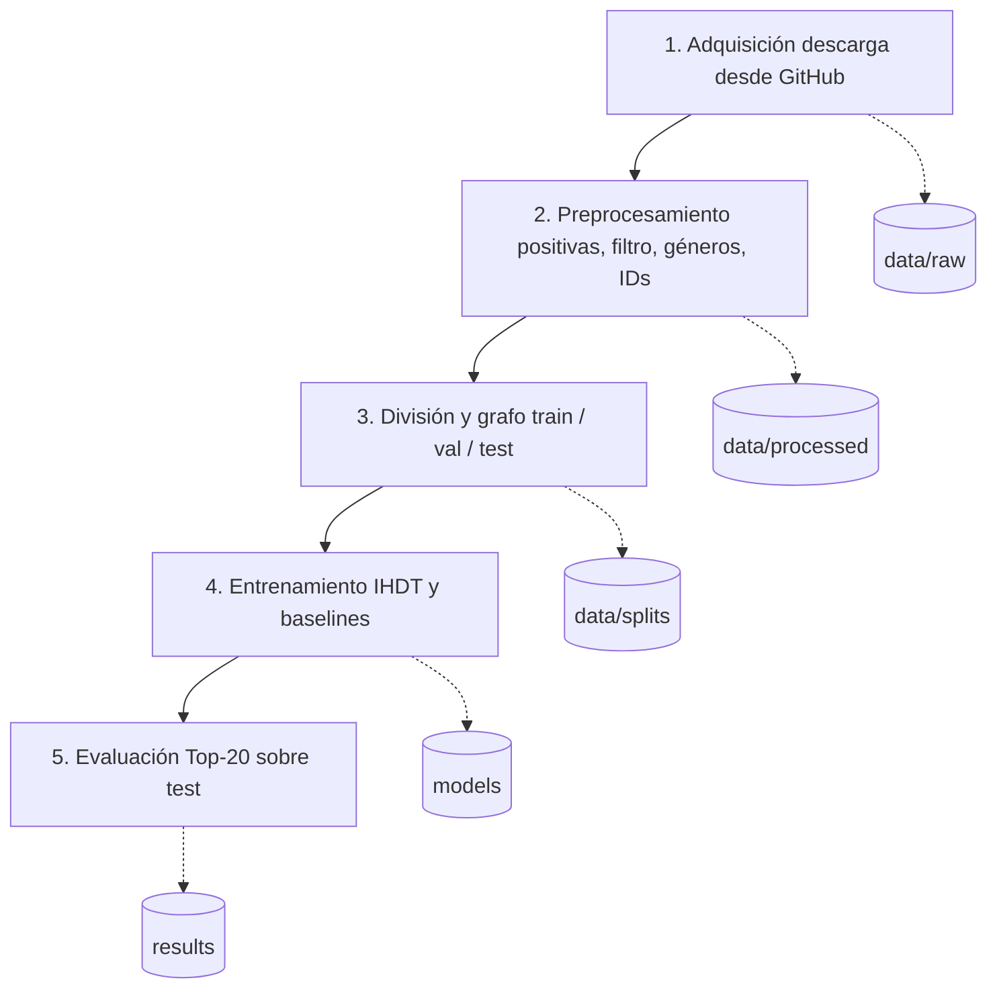
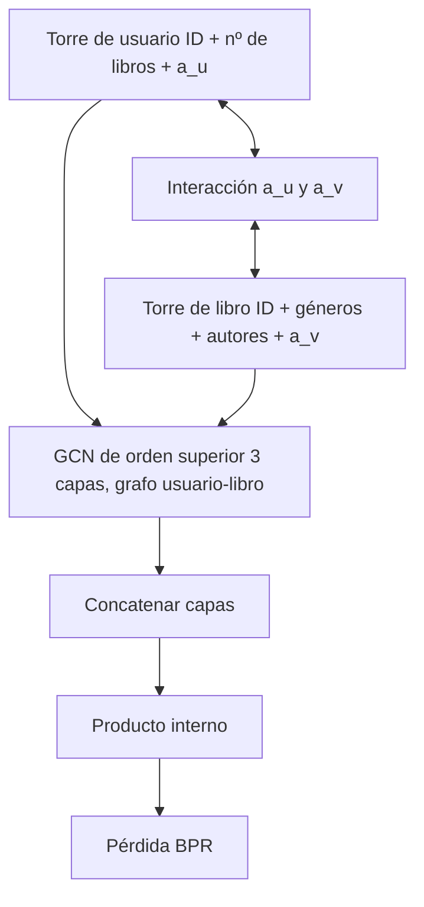

# Recomendador de libros con un modelo de dos torres y redes de grafos (IHDT)

Proyecto de la materia **Aplicaciones en Deep Learning**.
Autores: `Freddy Alexander Forero y Jhoan Ricardo Avila` · Repositorio: `https://github.com/FreddyForero1988/Proyecto-Final-Ap_Deep_Learning.git`

## 1. Problema

Hay tantos libros disponibles que encontrar el siguiente libro que valga la pena
leer es difícil. Este proyecto resuelve la tarea de **recomendación Top-K**: dado un
lector con su historial de calificaciones, ordenar libros que **aún no ha leído** y
que probablemente le interesen.

Las dificultades técnicas son las que señala la literatura: matrices usuario-libro
muy dispersas (cerca de 99 % de dispersión en este dataset) y la dificultad de
capturar relaciones indirectas entre lectores y libros.

**Modelo:** adaptación a libros del modelo *Interactive Higher-order Dual Tower*
(IHDT) de He, Li y Cai (2024), que combina la rapidez de un modelo de dos torres con
la capacidad de una red convolucional de grafos (GCN) de orden superior.

**Éxito:** comparar IHDT contra baselines (popularidad, MF-BPR y LightGCN) con
Precision, Recall, NDCG y HR @20 sobre un conjunto de prueba.

## 2. Datos

Todos los datos vienen de un único origen público: el repositorio
[`zygmuntz/goodbooks-10k`](https://github.com/zygmuntz/goodbooks-10k) (datos de Goodreads).
Se descargan por URL con `src/data.py`; no se suben al repositorio.

| Archivo | Contenido | Uso |
|---|---|---|
| `ratings.csv` | 5 976 479 calificaciones (1 a 5) de 53 424 lectores sobre 10 000 libros | Interacciones |
| `books.csv` | Metadatos de los 10 000 libros | Autor y cruce de IDs |
| `book_tags.csv` | Etiquetas por libro (`goodreads_book_id`, `tag_id`, `count`) | Géneros |
| `tags.csv` | Nombres de las etiquetas | Géneros |

`to_read.csv` no se usa.

## 3. Pipeline



### Etapa 2. Preprocesamiento (`src/data.py`)

1. **Verificaciones mínimas:** los IDs de `ratings` existen en `books`; se eliminan pares usuario-libro duplicados.
2. **Interacción positiva:** calificación ≥ 4. Las demás no se usan; los negativos para el entrenamiento se muestrean.
3. **Filtro por lector:** mínimo de interacciones positivas por lector (`min_pos_per_user`, 5 por defecto).
4. **Atributos del libro:**
   - *Géneros:* las etiquetas son estantes de usuarios y son ruidosas (`to-read`, `favorites`, `owned`...). Se agrupan en 36 géneros (`GENRE_MAP` en `src/config.py`) y se conservan los 5 más frecuentes por libro. Se excluye `fiction` porque aparece en ~77 % de los libros y no discrimina.
   - *Autores:* de `books.csv` (hasta 3 por libro).
   - Se excluyen `average_rating` y `ratings_count`: son señales de popularidad que harían al modelo parecerse al baseline de popularidad.
5. **Reindexado:** IDs contiguos de lectores y libros.

### Etapa 3. División y grafo

División **por lector**: 10 % a test; del resto, 10 % a validación; semilla fija (42).
El grafo usuario-libro se construye **solo con el conjunto de entrenamiento** para evitar fuga de información.

## 4. Modelo (`src/models.py`)



- **Torres:** `Linear → ReLU → normalización L2`, embeddings de 64 dimensiones.
- **Interacción:** `a_u` es el promedio de los libros que el lector calificó bien y `a_v` el promedio de los lectores que calificaron bien el libro; cada torre recibe el resumen del otro lado.
- **GCN:** 3 capas tipo NGCF sobre el grafo usuario-libro; el embedding final concatena todas las capas.
- **Entrenamiento:** pérdida BPR con un negativo por interacción positiva, Adam, regularización L2 de 1e-5 (como *weight decay*) y *early stopping* sobre Recall@20 de validación.

**Baselines:** popularidad, MF-BPR (LightGCN con 0 capas) y LightGCN.

### Diferencias respecto al paper

| Aspecto | Paper (He et al., 2024) | Este proyecto | Motivo |
|---|---|---|---|
| Datos | MovieLens-1M y 10M | goodbooks-10k | Dominio de libros |
| Atributos de usuario | Sí | No hay: ID y nº de libros leídos | El dataset no los trae |
| Mecanismo de interacción (Ec. 1) | Definido sin detalle | Promedio de vecinos (`a_u`, `a_v`) | Interpretación propia |
| Grafo | Heterogéneo con meta-paths | Grafo usuario-libro para la propagación; géneros y autores entran como atributos de la torre de libro | Simplificación para mantener el pipeline mínimo |
| Learning rate | 1e-4 | 1e-3 (igual para todos los modelos) | Pocas épocas disponibles |
| Épocas / paciencia | 1000 o 400 / 50 | 50 / 10 | Tiempo de cómputo |
| Framework | TensorFlow y PyTorch | Solo PyTorch | Simplicidad |

## 5. Evaluación (`src/evaluate.py`)

Métricas @20 promediadas sobre los lectores: **Precision** (aciertos / K), **Recall** (aciertos / libros
relevantes del lector), **HR** (1 si hay al menos un acierto) y **NDCG**. Los libros que el lector ya
tiene en entrenamiento (y validación, al evaluar en test) se excluyen del ranking.

## 6. Cómo ejecutar

**Google Colab (recomendado, con GPU):** abre `notebooks/02_pipeline.ipynb`.

**Línea de comandos:**

```bash:
git clone https://github.com/<tu-usuario>/recomendador-libros-ihdt.git
cd recomendador-libros-ihdt
pip install -r requirements.txt

python -m src.train --model all                                  # pipeline completo
python -m src.train --model all --user_frac 0.05 --epochs 2      # prueba rápida
python -m src.train --help                                       # todas las opciones
```

Los datos se descargan solos en la primera ejecución y se guardan en `data/` (en caché mientras no cambien los parámetros de preprocesamiento).

## 7. Estructura

```
├── README.md
├── requirements.txt
├── .gitignore               # excluye data/ y models/
├── notebooks/
│   ├── 01_eda.ipynb         # exploración de datos (se ejecuta una vez)
│   └── 02_pipeline.ipynb    # ejecuta el pipeline completo en Colab
├── src/
│   ├── config.py            # rutas, fuentes y parámetros
│   ├── data.py              # etapas 1-3: descarga, preprocesamiento, división y grafo
│   ├── models.py            # IHDT, LightGCN/MF y popularidad
│   ├── train.py             # etapa 4 y ejecución del pipeline
│   └── evaluate.py          # etapa 5: métricas Top-K
├── results/                 # métricas y curvas (sí se suben)
└── docs/                    # diagramas e informe
```

## 8. Resultados

> Pendiente: pegar aquí la tabla de `results/comparison_test.csv` después de la ejecución completa.

| Modelo | Precision@20 | Recall@20 | NDCG@20 | HR@20 |
|---|---|---|---|---|
| Popularidad | | | | |
| MF-BPR | | | | |
| LightGCN | | | | |
| IHDT | | | | |

## 9. Limitaciones

- Los datos son lectores generales de Goodreads y los 10 000 libros más calificados: hay sesgo hacia lo popular. "Libros nuevos" significa libros que el lector aún no ha leído, no libros recién publicados.
- Evaluación offline, sin lectores reales; una sola semilla.
- Las etiquetas de género vienen de toda la comunidad de Goodreads, no solo de los lectores del dataset.
- Los hiperparámetros no se ajustaron más allá de los valores del paper.

## 10. Referencias

- He, Q., Li, X. y Cai, B. (2024). Graph neural network recommendation algorithm based on improved dual tower model. *Scientific Reports*, 14, 3853. https://doi.org/10.1038/s41598-024-54376-3
- Roy, D. y Dutta, M. (2022). A systematic review and research perspective on recommender systems. *Journal of Big Data*, 9, 59. https://doi.org/10.1186/s40537-022-00592-5
- Wayesa, F., Leranso, M., Asefa, G. y Kedir, A. (2023). Pattern-based hybrid book recommendation system using semantic relationships. *Scientific Reports*, 13, 3693. https://doi.org/10.1038/s41598-023-30987-0
- He, X. et al. (2020). LightGCN: Simplifying and powering graph convolution network for recommendation. *SIGIR*, 639–648. https://doi.org/10.1145/3397271.3401063
- Wang, X. et al. (2019). Neural graph collaborative filtering. *SIGIR*. https://doi.org/10.1145/3331184.3331267
- Dataset: `zygmuntz/goodbooks-10k`. https://github.com/zygmuntz/goodbooks-10k
